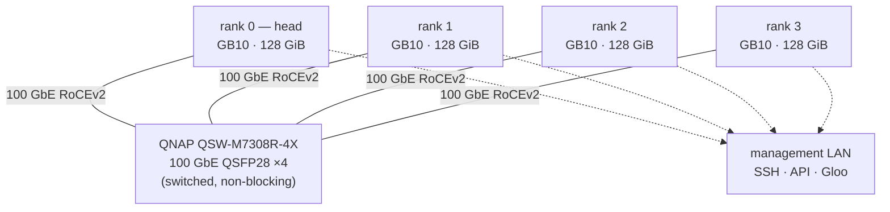

# DeepSeek V4.1 Flash on four GB10 systems over a switched 100 GbE fabric

A tested, reproducible reference deployment of **DeepSeek-V4.1-Flash-1017** at
**TP4** across four **NVIDIA GB10** systems connected through a conventional
**switched 100 GbE RoCEv2 fabric** — one QSFP28 port per node instead of a
cabled ring.

---

## Attribution: whose work this is

**Christopher Owen developed and maintains both upstream projects this
deployment runs on:**

- **[`christopherowen/spark-ds41f`](https://github.com/christopherowen/spark-ds41f)** —
  the optimised DeepSeek V4.1 Flash vLLM runtime, its build system, its
  container and image recipe, and its `bin/spark` lifecycle CLI.
- **[`christopherowen/dgx-spark-networking`](https://github.com/christopherowen/dgx-spark-networking)**
  ("SparkNet") — the RoCE transport layer: topology/node-map tooling, the NCCL
  transport profiles, and the one-shot collective implementation.

Stated plainly, because it is easy to misread a deployment repository:

1. **The switched transport is already implemented upstream in SparkNet.** The
   `switched` profile (`transport: oneshot-switched`) is Owen's, and it covers
   any node count from two to sixteen. We selected it; we did not write it.
2. **METIQ Solutions did not develop a separate inference runtime, a patched
   kernel, or a switched transport.** Our runtime is Owen's unmodified upstream
   source at a pinned release. We did not patch his source tree or his scripts.
3. **METIQ's contribution is the deployment around it:** a validated four-node
   switched-fabric deployment on ASUS GX10 hardware, the site configuration that
   expresses it, integration guidance for doing the same on your own GB10
   systems, validation procedures, performance measurements, and the operating
   experience we accumulated getting it to run.
4. **This repository is a companion deployment reference — not a fork, not a
   replacement, and not a redistribution of Owen's code.** Nothing from the
   upstream source tree is vendored here. For runtime behaviour, updates and
   runtime bugs, use his repositories and his issue trackers.

Upstream is the authority for everything about the runtime and the transport.
Where this document and upstream disagree, upstream is right, and the version
you pinned is the version that matters.

---

## What this repository provides

| | |
| --- | --- |
| A working switched site profile | [`configs/cluster.example.json`](configs/cluster.example.json) — a complete, validated `bin/spark` cluster profile using Owen's `switched` transport profile |
| A switched node map | [`configs/nodes.example.json`](configs/nodes.example.json) — four ranks, one rail per node, rendezvous on the management interface |
| The configuration delta | [`docs/switched-configuration.md`](docs/switched-configuration.md) — every difference between Owen's reference `tp4-ring` profile and our switched profile, classified by *why* it differs |
| Network build-out and checks | [`docs/hardware-and-network.md`](docs/hardware-and-network.md), [`scripts/validate-fabric.sh`](scripts/validate-fabric.sh) |
| Install procedure | [`docs/installation.md`](docs/installation.md) — ten stages, all through Owen's own tooling |
| Validation procedure | [`docs/validation.md`](docs/validation.md) — fabric, collective, API and long-context checks |
| Measurements | [`docs/performance.md`](docs/performance.md), [`benchmarks/`](benchmarks/) |
| What went wrong, and why | [`docs/troubleshooting.md`](docs/troubleshooting.md), [`docs/operational-notes.md`](docs/operational-notes.md) |

This repository contains **no runtime code**. There is no launcher, no
orchestration layer and no alternative management framework: start, stop,
status, doctor, collective probe and benchmarks are Owen's `bin/spark`
subcommands, invoked as he documents them. Nothing is installed on the hosts,
and no configuration-management system or CI runner is needed — if you can SSH
into the four nodes, you can run this.

---

## Validated hardware

**Tested by us, in this configuration, on this fabric:**

| Component | What we ran |
| --- | --- |
| Compute | **4 × ASUS Ascent GX10**, NVIDIA GB10 Grace Blackwell, 128 GiB unified memory per node |
| Interconnect | **QNAP QSW-M7308R-4X** 100 GbE switch (4 × QSFP28 100GbE, 1200 Gbps switching capacity) |
| Per-node fabric port | **1 × 100 GbE QSFP28**, one port per node, port 1 of the on-board ConnectX-7 |
| Fabric addressing | One IPv4 `/24` on the 100 GbE interface per node, MTU 9000 |
| Management network | Separate 1 GbE/10 GbE interface per node: SSH, the OpenAI-compatible API, Gloo and TP rendezvous |
| Topology | **Switched, fully connected.** Every rank reaches every other rank through the switch; no rank-to-rank cabling |
| Parallelism | **TP4**, PP1 — one head (rank 0) and three workers |
| Host platform | DGX OS 26.09.2-class base, kernel `7.0.0-1019-nvidia-64k` (64 KiB pages), NVIDIA driver `580.178.04`, signed UVM memory-saver DKMS module |

**Expected to be compatible, but not independently tested by us:**

- **NVIDIA DGX Spark** (the GB10 reference platform) in the same four-node
  switched shape. The upstream project is developed on DGX Sparks; our
  validation is on ASUS GX10 boards, which are a different GB10 carrier with
  different fan/EC firmware.
- **Other switched 100 GbE or faster RoCEv2 switches** that pass the fabric
  qualification in [`docs/validation.md`](docs/validation.md).
- **More than one RDMA device path per node.** Upstream's switched node map
  supports one or two rails (`roce_hcas`) with up to four devices for NCCL
  (`nccl_hcas`), and documents roughly double the all-pairs bandwidth when both
  device paths of a switch port are listed. We ran a single path, so we have no
  first-hand multi-path measurement.
- **Node counts other than four.** The upstream switched profile accepts two to
  sixteen nodes, but only four nodes at TP4 has run on hardware anywhere that we
  know of. See the qualification-scope note in Owen's
  [`docs/switched-fabric.md`](https://github.com/christopherowen/spark-ds41f/blob/main/docs/switched-fabric.md).

If you are on a different GB10 board, expect to revisit the fan/thermal policy
(see [`docs/hardware-and-network.md`](docs/hardware-and-network.md)) and to
re-run fabric qualification before you trust any number in this repository.

---

## Software

Everything below is a pinned identity, not a version range.

| Component | Pinned identity |
| --- | --- |
| Runtime | `spark-ds41f-1030` |
| Runtime source commit | `9461a70546fcfdcac9c7d8fbc58a53230510fbc9` |
| Runtime release recipe | `releases/spark-ds41f-1030/cluster.json` |
| SparkNet | `v0.5.0`, commit `ed6af327a8953eb71de2ed925a5e605cb5eb6e20` |
| Model | `deepseek-ai/DeepSeek-V4.1-Flash-1017`, revision `1bae0e1088993b9b82de08f59de5be5a34e42170` (native BF16 weights, MIT-licensed on Hugging Face) |
| Transport | SparkNet `switched` profile → `oneshot-switched`; `SPARKNET_ROCE_TOPOLOGY=direct` |
| Parallelism | TP4, PP1 |
| Context | 1,048,576 tokens configured and exercised |
| Kernels | TileLang attention/linear/MoE backends, DSpark speculative decoding (k=5) |
| Container image | Built by *you* from the pinned upstream sources on one node; upstream does not publish an image, and we do not publish ours |

The upstream recipe selects the `1017` checkpoint (`v41-flash-1017`), whose
config, tokenizer and tensor layout match the original `DeepSeek-V4.1-Flash`
release but whose weights all differ. Do not mix caches between the two.

---

## Topology



One cable per node into the switch. The fabric carries tensor-parallel
all-reduce and all-gather only; the management network carries SSH, the API,
Gloo rendezvous and the `TP_SOCKET_IFNAME`/`NCCL_SOCKET_IFNAME` bootstrap
channel. The two are separate interfaces and must stay that way — see
[`docs/hardware-and-network.md`](docs/hardware-and-network.md).

---

## Quick start

The full procedure, with prerequisites and checks, is
[`docs/installation.md`](docs/installation.md). This is the shape of it.
Values in `<angle brackets>` must be replaced with your own.

### 1. Prepare the four nodes

Each node: DGX OS 26.09.2 or later, Docker with the NVIDIA container runtime,
`/dev/infiniband`, ~480 GiB free disk for the checkpoint and caches, the 64 KiB
kernel profile and the memory-saver module (both required by the recipe's
`host.kernel` block), and passwordless SSH plus passwordless `sudo` from the
head node to every node as one user.

```sh
getconf PAGESIZE                 # must print 65536
nvidia-smi --query-gpu=driver_version --format=csv,noheader
```

### 2. Connect and configure the switched network

One QSFP28 port per node into the switch. One IPv4 `/24` per node on the 100 GbE
interface, MTU 9000, RoCEv2 on GID index 3. Then verify — from **every** node:

```sh
./scripts/validate-fabric.sh \
  --interface enp1s0f1np1 \
  --hca rocep1s0f1 \
  --gid-index 3 \
  --mtu 9000 \
  --peers 10.100.0.12,10.100.0.13,10.100.0.14

ping -c2 -M do -s 8972 10.100.0.12      # jumbo-frame reachability
```

`validate-fabric.sh` is read-only: it inspects the interface, the HCA's GID
table, the RDMA device mapping and peer reachability, and changes nothing. See
[`docs/validation.md`](docs/validation.md) for the optional bandwidth check.

### 3. Obtain the upstream repositories

```sh
git clone https://github.com/christopherowen/spark-ds41f.git
git -C spark-ds41f checkout 9461a70546fcfdcac9c7d8fbc58a53230510fbc9

git clone https://github.com/christopherowen/dgx-spark-networking.git
git -C dgx-spark-networking checkout ed6af327a8953eb71de2ed925a5e605cb5eb6e20

export PYTHONPATH="$PWD/dgx-spark-networking"      # SparkNet renders the profile
```

Run every `bin/spark` command from the root of the `spark-ds41f` checkout.

### 4. Prepare the model checkpoint

On **every** node, in the Hugging Face cache the profile mounts
(`{home}/.cache/huggingface/hub` by default):

```sh
hf download deepseek-ai/DeepSeek-V4.1-Flash-1017 \
  --revision 1bae0e1088993b9b82de08f59de5be5a34e42170
```

A snapshot directory appearing is **not** completion evidence. The index
declares ~510.3 GB of weights; confirm them offline before starting:

```sh
HF_HUB_OFFLINE=1 hf download deepseek-ai/DeepSeek-V4.1-Flash-1017 \
  --revision 1bae0e1088993b9b82de08f59de5be5a34e42170
```

### 5. Create your site configuration

```sh
cp <this-repo>/configs/cluster.example.json spark-ds41f/config/tp4-switched.local.json
cp <this-repo>/configs/nodes.example.json   spark-ds41f/config/nodes.json

$EDITOR spark-ds41f/config/nodes.json                 # names, ranks, IPs, interfaces, user
$EDITOR spark-ds41f/config/tp4-switched.local.json    # host.home, master_addr, port, paths
```

Both filenames are already ignored by the upstream `.gitignore`, which
`cluster sync` requires: your site files must not make the checkout dirty.

### 6. Select the upstream switched profile

The profile *is* the selection. It contains:

```json
"fabric": { "transport": "oneshot-switched", "topology": "switched" }
```

and it carries Owen's `switched` profile environment verbatim. You do not add
NCCL settings by hand — the renderer derives per-rank `NCCL_IB_HCA`,
`SPARKNET_ROCE_HCA`, `SPARKNET_ROCE_GID_INDEX` and the socket interfaces from
your node map. Adding the ring's NCCL controls is an error, not a tuning choice
(see [`docs/switched-configuration.md`](docs/switched-configuration.md)).

### 7. Validate the configuration

```sh
bin/spark --cluster-config config/tp4-switched.local.json doctor
bin/spark --cluster-config config/tp4-switched.local.json render <head-node>
```

`doctor` (configuration coherence, touches no node) must report
`configuration OK`. `render` prints the per-rank environment that will be used,
and is the fastest way to see the fabric contract before anything starts.

### 8. Start the runtime with Owen's native tooling

Build the image on one idle node, then start from the head node:

```sh
# once, on the build host
bin/spark --cluster-config config/tp4-switched.local.json build prepare
bin/spark --cluster-config config/tp4-switched.local.json build image --apply

# on the head node
bin/spark --cluster-config config/tp4-switched.local.json cluster sync  --apply
bin/spark --cluster-config config/tp4-switched.local.json cluster start --apply --unqualified-shape
bin/spark --cluster-config config/tp4-switched.local.json doctor --live
```

`--unqualified-shape` is required because this profile has no upstream
`benchmark_reference`: our shape is a site shape, not a release-qualified one.
It acknowledges that you accept that; it does not disable any check.

Stop with the same profile you started from:

```sh
bin/spark --cluster-config config/tp4-switched.local.json cluster stop --apply
```

### 9. Check readiness and run inference

```sh
curl -s http://<head>:8000/v1/models | jq -r '.data[].id'
curl -s http://<head>:8000/v1/chat/completions \
  -H 'Content-Type: application/json' \
  -d '{"model":"deepseek-v4.1-flash","messages":[{"role":"user","content":"Reply with the single word: ready"}],"max_tokens":16,"chat_template_kwargs":{"thinking":false}}' | jq -r '.choices[0].message.content'
```

Then prove the fabric actually carried the collectives —
[`docs/validation.md`](docs/validation.md) covers the collective probe and the
trace check.

### 10. Measure

```sh
bin/spark bench                  # upstream's own check, ~6 minutes
```

This profile has no upstream reference run for its shape, so `bench` measures
and reports without comparing against another fabric's numbers — which is the
honest behaviour. Pass `--compare PATH` once you have your own baseline.

Use `bin/spark bench` as your baseline before you trust anyone else's numbers,
including ours. Our measurements, definitions and caveats are in
[`docs/performance.md`](docs/performance.md) and [`benchmarks/`](benchmarks/).

---

## Performance at a glance

Four GB10 nodes, TP4, switched 100 GbE, `spark-ds41f-1030`, checkpoint `1017`.
Full conditions, harness descriptions and caveats:
[`docs/performance.md`](docs/performance.md).

**Eight-stream and single-stream decode**, measured with Owen's own `servebench`
workload (closed loop, 60 s warmup, 300 s measurement, 256-token completions,
thinking off), two repetitions each:

| Load | Ours (aggregate decode) | Upstream 1030 reference (ring, 200 Gb/s) | Difference |
| --- | ---: | ---: | ---: |
| C1 (one conversation) | **77.6 tok/s** | 78.3 tok/s | −0.8% |
| C8 (eight streams) | **194.6 tok/s** | 198.4 tok/s | −1.9% |

**Concurrency sweep**, a different harness (long-generation, 1,024-token
outputs, three repetitions, ~8K and ~32K inputs). Aggregate decode throughput:

| Input tokens | C1 | C2 | C4 | C8 | C16 |
| ---: | ---: | ---: | ---: | ---: | ---: |
| 7,087 | 85.4 | 126.3 | 179.0 | 250.7 | 337.3 |
| 31,692 | 85.1 | 125.7 | 179.9 | 249.9 | 332.8 |

**Source-text prefill**, three samples per size, one-token output:

| Prompt tokens | Ours (tok/s) | Upstream 1030 reference (tok/s) | Difference |
| ---: | ---: | ---: | ---: |
| 32,768 | 5,935 | 7,313 | −18.8% |
| 131,072 | 6,044 | 7,396 | −18.3% |
| 262,144 | 5,853 | 7,120 | −17.8% |
| 524,288 | 5,443 | 6,538 | −16.7% |
| 1,000,000 | 4,734 | 5,549 | −14.7% |

**Other validated behaviour:**

| Property | Result |
| --- | --- |
| Maximum context | 1,048,576 tokens configured; requests answered at that length |
| Near-1M retrieval | **6 of 6** exact retrievals at 25%, 50% and 75% depth of the full context |
| Stability soak | **124.5 min**, 43 cycles, **417/417** requests, 43/43 conversations, 10/10 tool round-trips, no OOM, no PSI, no swap-out, no restart |
| Memory headroom | ≥ 21.7 GiB `MemAvailable` per node through the soak; zero OOM-kill deltas |
| Fabric | ~11,677 MB/s (≈93.4 Gb/s) `ib_read_bw` per node pair, 1 MiB messages |

**How to read these numbers.** Three things are mixed together here, and we
will not pretend otherwise:

- The switched transport is *not* demonstrably faster than a ring. Upstream
  measured the transport at +3.1% geometric mean across 24 cells and explicitly
  called it "no worse, possibly a few percent better, not a transport win". We
  did not run a controlled ring-versus-switch A/B on our own hardware, so we
  make no such claim in either direction.
- Our prefill is **14–19% below** the upstream ring reference. We cannot
  attribute that gap: the fabric differs (100 GbE switched versus 200 Gb/s
  ring), and we did not isolate the cause. It is a measured result, not an
  explanation.
- The C1/C8 harness and the concurrency-sweep harness are **different
  workloads**; a number from one is not comparable with a number from the other.
  Our C1/C8 rows are the ones comparable with upstream's published figures.

---

## Limitations

Recorded because a reference deployment is only useful if it says where it
stops being one.

- **Not production-qualified by us.** We validated this deployment for our own
  use and continue to treat it as experimental. It has no upstream
  `benchmark_reference` for this shape, and `cluster start` treats it as
  unqualified by design.
- **One rail per node.** We cabled one ConnectX-7 port per node. Upstream
  documents that a switch port is reached through two HCA device paths and that
  listing only one halves fabric bandwidth (~112 Gb/s versus ~196 Gb/s on their
  hardware). Our second device path had no IPv4 address, so we excluded it
  rather than change host networking. Our ~93.4 Gb/s per-pair measurement is
  consistent with a single path, and we did **not** measure an all-pairs
  aggregate.
- **No RoCE traffic-class marking.** We left `roce_traffic_class` unset, so
  RoCE packets rode the default (best-effort) class. The example configuration
  sets the upstream-recommended DSCP 26 / ECT(0) byte (106); if you use it, the
  host and the switch must agree on the priority mapping, and we have no
  measurement of the difference. Our switch-side PFC/ECN configuration for the
  validation runs was not recorded.
- **Prefill below upstream reference.** See above; unexplained.
- **Single-rail, single-switch, single-vendor.** One switch model, one node
  count, one model, one checkpoint, one kernel configuration.
- **Not tested:** C32 or above (`max_num_seqs=16` is the configured cap),
  multiple simultaneous 1M contexts, two-rail fabrics, three-node switched
  fabrics, live failover, or mixing GB10 board vendors in one cluster.
- **Not measured:** engine step rate as a time series, per-NCCL-operation
  attribution of fabric traffic (we have aggregate RoCE counters), and any
  controlled comparison against a ring on identical hardware.

---

## Upstream links

| Purpose | Where |
| --- | --- |
| Runtime, build, lifecycle, benchmarks | <https://github.com/christopherowen/spark-ds41f> |
| Runtime issues | <https://github.com/christopherowen/spark-ds41f/issues> |
| Switched-fabric design and qualification scope | [`docs/switched-fabric.md`](https://github.com/christopherowen/spark-ds41f/blob/main/docs/switched-fabric.md) |
| Setup, host baseline, recovery | [`docs/setup.md`](https://github.com/christopherowen/spark-ds41f/blob/main/docs/setup.md), [`docs/recovery.md`](https://github.com/christopherowen/spark-ds41f/blob/main/docs/recovery.md) |
| SparkNet (RoCE transport, NCCL profiles, topology tooling) | <https://github.com/christopherowen/dgx-spark-networking> |
| Memory-saver DKMS module | <https://github.com/christopherowen/dgx-spark-memory-saver> |
| Fan-floor control (NVIDIA P4242 boards) | <https://github.com/christopherowen/dgx-spark-fan-control> |

Please report runtime, transport and NCCL issues upstream. Issues with *this
deployment description* — the site profile, the fabric build-out, the
procedures, the measurements — belong here.

---

## Licence

This repository is licensed under the **Apache License 2.0** ([`LICENSE`](LICENSE)).
Third-party acknowledgements are in [`NOTICE.md`](NOTICE.md).

It redistributes no model weights, no container images, no third-party source
code and no third-party binaries. Everything it references is fetched from an
upstream source at a pinned revision.
